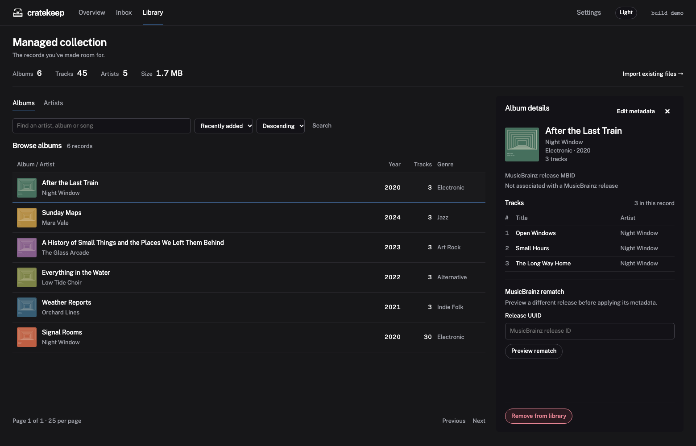
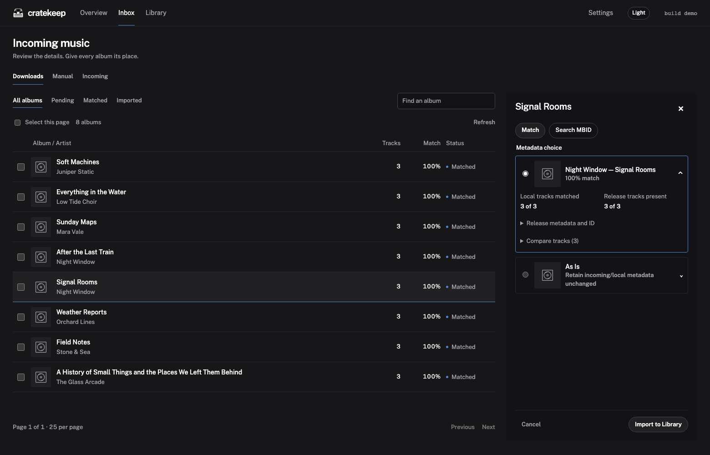

<div align="center">


# Cratekeep

[](https://github.com/kylejschultz/cratekeep/actions/workflows/container.yml)
[](LICENSE)
[](https://discord.gg/QgkUzqa2Mw)
[](https://github.com/sponsors/kylejschultz)
[](https://ko-fi.com/kylejschultz)

</div>

Cratekeep is a self-hosted app for organizing a music collection with [Beets](https://beets.io/) and [MusicBrainz](https://musicbrainz.org/). Match albums, correct tags and artwork, and check the changes before they reach your music player.



Downloads arrive through named Inbox folders. Cratekeep copies them into your Library and tags the copies, leaving the originals available until you remove them. You can also bring an existing collection into Cratekeep without moving its files.

Matching works with complete albums or just a few tracks. Choose a MusicBrainz result, enter a release ID, or keep the existing tags. The review panel lets you compare track names and metadata before importing one album or a selected batch.



## Install

Cratekeep runs in Docker on Linux/amd64 and Linux/arm64.

> Cratekeep can change tags and delete files when requested. It has no built-in authentication or CSRF protection, so use a trusted network or an authenticating reverse proxy. Start with copies of a few albums.

### Docker Compose

Replace the host paths with your own folders and save as `compose.yaml`:

```yaml
services:
  app:
    image: ghcr.io/kylejschultz/cratekeep:latest
    user: "1000:1000" # UID:GID with write access to your folders
    ports:
      - "8788:8788"
    environment:
      STATE_PATH: /data/config
    volumes:
      - /path/to/inbox:/data/inbox     # Inbox location
      - /path/to/music:/data/library  # Library path, new or existing
      - /path/to/config:/data/config  # Persistent settings and database
    restart: unless-stopped
```

Start Cratekeep:

```sh
docker compose up -d
```

<details>
<summary>Plain Docker</summary>

Use your own folder paths and the same UID:GID permissions as above:

```sh
docker run -d \
  --name cratekeep \
  --restart unless-stopped \
  --user 1000:1000 \
  -p 8788:8788 \
  -e STATE_PATH=/data/config \
  -v /path/to/inbox:/data/inbox \
  -v /path/to/music:/data/library \
  -v /path/to/config:/data/config \
  ghcr.io/kylejschultz/cratekeep:latest
```

</details>

### Unraid

Community Applications approval is pending.

## Getting started

Open **http://localhost:8788**, or use your server's address. During setup, choose `/data/inbox` and `/data/library` for the example mounts. Add more Inbox folders in Settings.

Use **Inbox** for downloads and **Library → Import existing files** for music already in your Library folder. Inbox imports copy files and tag the copies; Library Import leaves files in place. Choose a match, review the changes and import individually or in batches.

Eligible copy imports can be undone; replacements cannot. **Remove imported** deletes the Inbox originals and keeps the Library copies.

## Analytics

Optional [Beacon analytics](https://github.com/kylejschultz/beacon) is off by default. It reports a random installation ID, build/platform details and collection totals at most once a day, without track names, media paths or listening history. The receiving server also sees the connection IP address. You can opt in under Settings → About.

## Updates and help

Stop Cratekeep with `docker compose stop app`, then back up your config directory and music before updating. Keep the same mounts and user settings:

```sh
docker compose pull app
docker compose up -d app
```

For questions, [join the Discord](https://discord.gg/QgkUzqa2Mw). Report bugs and feature requests in [GitHub Issues](https://github.com/kylejschultz/cratekeep/issues), including your build identifier and relevant logs with private details removed.

## License

Cratekeep is licensed under the [GNU General Public License v3.0](LICENSE).
